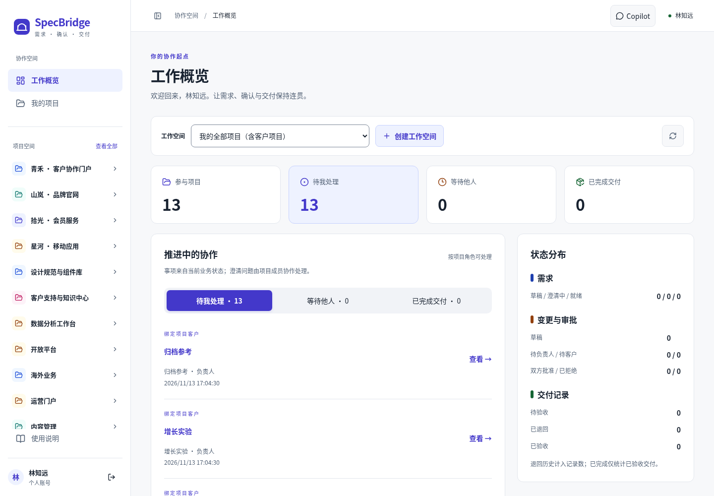

<div align="center">
  
  <h1>SpecBridge</h1>
  <p><strong>让需求、确认与交付保持连接。</strong></p>
  <p>面向独立开发者与小型软件团队的需求澄清、范围变更审批和交付验收平台。</p>

  <p>
    
    
    
    
  </p>

  <p>
    <a href="#快速开始">快速开始</a> ·
    <a href="docs/guides/USER_GUIDE.md">使用指南</a> ·
    <a href="docs/README.md">文档中心</a> ·
    <a href="docs/STATE.md">项目状态</a> ·
    <a href="https://github.com/lithuio/specbridge/issues">Issues</a>
  </p>
</div>

---

SpecBridge 把客户提出的需求整理为可追溯的规格版本，再将范围、费用和工期影响交由双方确认，最终依据同一批准版本交付和验收。AI 可以协助澄清和整理，商业审批与验收始终由人完成。

> **当前状态**：核心协作流程及 AI / MCP 扩展已有本地实现与验证记录，可按下文运行。生产部署、独立人工验收和发布检查仍需完成；具体进度见 [STATE](docs/STATE.md) 与 [人工待办](docs/HUMAN_TASKS.md)。产品基线版本为 v0.2，不等同于软件发布版本。

## 界面预览



_现有本地浏览器验证截图，使用合成演示数据。更多界面见 [视觉与交互记录](docs/ux/evidence/ai-workflow-polish/README.md)。_

## 可以做什么

| 能力               | 使用方式                                                                       |
| ------------------ | ------------------------------------------------------------------------------ |
| 项目协作           | 建立工作空间、记录初始范围，分配开发者与唯一客户审批人                         |
| 需求澄清           | 保存需求原文、追加问答，整理正文与验收标准，生成不可变规格版本                 |
| 范围与商业确认     | 评估工时、费用和工期，提交冻结版本，由 Owner → Client 顺序审批                 |
| 交付验收           | 为已批准版本提交 HTTPS 成果链接，客户接受或退回，保留每次交付历史              |
| 项目背景与 AI 辅助 | 上传背景资料、按版本共享；按需生成澄清或规格建议，保存个人工作稿，人工确认提案 |
| Agent 接入         | 通过项目访问凭据、本地 MCP 和 Skill，让外部 Agent 只读已批准规格               |

### 一条完整的协作流程


- **Owner** 管理工作空间、项目与成员，负责供应方商业审批。
- **Developer** 在被分配项目内澄清、整理规格、评估和交付。
- **Client** 在绑定项目内提需求、答复、审批和验收；每个项目最多一位客户审批人。

提交后的版本不能覆盖；审批期间不能新建相关需求修订；拒绝后重新提交需要双方重新审批。AI 故障或未配置时，仍可手动完成核心流程。完整步骤与异常处理见 [使用指南](docs/guides/USER_GUIDE.md)。

## 快速开始

### 环境要求

| 工具             | 仓库要求                                                                                |
| ---------------- | --------------------------------------------------------------------------------------- |
| Node.js          | 推荐 **22.23.4**，见 [.nvmrc](.nvmrc)；支持范围 `>=22.22.3 <23`                         |
| pnpm             | **10.34.9**，见 [package.json](package.json)                                            |
| Docker + Compose | 启动 PostgreSQL 17；当前 Compose 仅包含数据库                                           |
| Linux / WSL      | 完整背景文件解析、本地 Codex 连接使用此环境；解析还需 `/usr/bin/prlimit` 和可读 `/proc` |

以下命令使用 Bash，均在**仓库根目录**执行。完整配置、测试和故障排查见 [本地运行指南](docs/guides/GETTING_STARTED.md)。

### 1. 获取代码与配置

```bash
git clone https://github.com/lithuio/specbridge.git
cd specbridge

# 已使用现有工作区时，从这里开始；使用 nvm 管理 Node 时执行：
nvm install
nvm use
pnpm install --frozen-lockfile

# 只创建缺失文件，保留已有本机配置
test -e .env || cp .env.example .env
chmod 600 .env
```

在编辑器中打开 `.env`，将 `POSTGRES_PASSWORD` 和 `DATABASE_URL` 中的两处 `replace_me` 改为同一个本地数据库密码。可使用随机十六进制字符串；URL 中的特殊字符需要编码。默认 `DEEPSEEK_ENABLED=false`，无需模型密钥即可体验核心流程。

### 2. 初始化本地数据库

确认目标是自己的开发库；新环境应用仓库中已审阅的迁移，已有数据先备份。当前机器的迁移完成情况见 [STATE](docs/STATE.md)，已初始化环境可跳过 `db:migrate`。新增 SQL 仍遵循 [迁移审核流程](docs/engineering/DEVELOPMENT.md#后续数据库版本变更)。

```bash
# 避免当前终端遗留的其他环境配置覆盖根 .env
unset DATABASE_URL NODE_ENV
pnpm db:up
pnpm db:migrate
```

### 3. 启动 API 与 Web

```bash
# 终端 A：显式加载根 .env，监听 4000
pnpm dev:api
```

```bash
# 终端 B：监听 3000
pnpm dev:web
```

打开 **[http://localhost:3000](http://localhost:3000)**，注册账号并登录。仓库没有内置演示账号；注册后需单独登录。使用其他终端启动 API 时，也应确认没有遗留的 `DATABASE_URL` / `NODE_ENV`。

| 服务              | 本地地址                                         |
| ----------------- | ------------------------------------------------ |
| Web               | `http://localhost:3000`                          |
| API 健康检查      | `http://localhost:4000/api/v1/health`            |
| Web 同源 API 代理 | `http://localhost:3000/api/v1/health`            |
| 开发数据库        | `127.0.0.1:5433`，数据库 / 用户均为 `specbridge` |

日常启动只需 `pnpm db:up` 和两个开发终端。停止时在各服务终端按 `Ctrl+C`，再按需执行 `pnpm db:down`；该命令保留开发数据卷。

## 第一次使用

1. 分别注册 Owner、Developer、Client 三个账号，用独立浏览器配置登录。
2. Owner 创建工作空间和项目，填写初始范围；先把 Developer 加入工作空间，再分配到项目；绑定唯一 Client。
3. Client 创建需求，双方完成问答；Owner / Developer 创建规格版本并标记就绪。
4. Owner / Developer 填写商业评估并正式提交，由 Owner 和 Client 依次确认。
5. Owner / Developer 提交 HTTPS 成果链接，Client 验收；需要修改时保留旧记录并提交新交付。

初始范围创建后固定，仅作参考；通过变更单确认的版本才进入交付闭环。具体页面、金额填写示例、退回重提与 AI 使用见 [完整使用指南](docs/guides/USER_GUIDE.md)。

## 可选：AI 与本地 Agent

- **Web AI**：在服务端 `.env` 配置 DeepSeek 并启用，重启 API 后使用需求工作台与 Copilot。生成、保存个人稿、正式发布是不同操作；配置见 [AI 启用说明](docs/guides/GETTING_STARTED.md#可选启用-ai)。
- **本地 Agent**：构建 MCP 后，由 Owner 在项目「访问凭据 → 连接本地 Codex」生成安装命令并完成网页授权。外部工具只读批准规格，连接本身不需要 DeepSeek；见 [MCP 文档](apps/mcp/README.md)。

## 开发与验证

技术栈：**Next.js / React / Base UI · NestJS 模块化单体 · PostgreSQL / Drizzle · TypeScript · Vitest / Playwright**。

```text
specbridge/
├── apps/web/       # 页面、表单与客户端状态
├── apps/api/       # 权限、业务规则、事务、审计与持久化
├── apps/mcp/       # 本地 stdio MCP 与连接安装器
├── skills/        # requirement-analyst Agent Skill
├── infra/         # 开发 / 隔离测试数据库 Compose
├── scripts/       # 环境加载、测试编排与工作区检查
└── docs/          # 使用指南、规范、开发流程和验证记录
```

| 命令                    | 用途                                                  |
| ----------------------- | ----------------------------------------------------- |
| `pnpm lint`             | 各包静态检查                                          |
| `pnpm test`             | API / MCP 单元与 MCP 本地协议测试，不含完整浏览器回归 |
| `pnpm build`            | 构建 API、Web、MCP                                    |
| `pnpm test:integration` | PostgreSQL 集成测试，需要隔离测试库                   |
| `pnpm test:e2e:db`      | 使用隔离测试库的 HTTP / 代理链路回归                  |
| `pnpm test:browser`     | 构建并运行完整浏览器回归，需要 Chromium 与隔离测试库  |

数据库和浏览器测试的环境准备、端口要求见 [验证命令](docs/guides/GETTING_STARTED.md#运行检查与测试)。普通测试使用 Mock AI，不需要真实模型密钥。贡献前阅读 [开发工作流](docs/engineering/WORKFLOW.md) 和 [AGENTS.md](AGENTS.md)。

## 文档导航

| 想了解                         | 从这里开始                                                                                                          |
| ------------------------------ | ------------------------------------------------------------------------------------------------------------------- |
| 安装、配置、测试与排障         | [本地运行指南](docs/guides/GETTING_STARTED.md)                                                                      |
| 三角色流程、背景资料与 AI 操作 | [使用指南](docs/guides/USER_GUIDE.md)                                                                               |
| 产品范围与业务规则             | [PRD](docs/product/PRD.md) · [产品决策](docs/product/DECISIONS.md) · [验收标准](docs/product/ACCEPTANCE.md)         |
| 架构、接口与安全               | [架构](docs/architecture/ARCHITECTURE.md) · [API](docs/architecture/API.md) · [安全](docs/architecture/SECURITY.md) |
| 当前进度与人工待办             | [STATE](docs/STATE.md) · [HUMAN_TASKS](docs/HUMAN_TASKS.md)                                                         |
| 开发、阶段记录与证据           | [工程文档](docs/engineering/README.md)                                                                              |
| 文档如何组织和维护             | [文档中心](docs/README.md) · [文档规划](docs/engineering/DOCUMENTATION.md)                                          |

## 许可

仓库当前未提供项目级开源许可证，API 包标记为 `UNLICENSED`。第三方依赖的许可证不代表 SpecBridge 的授权条款。
