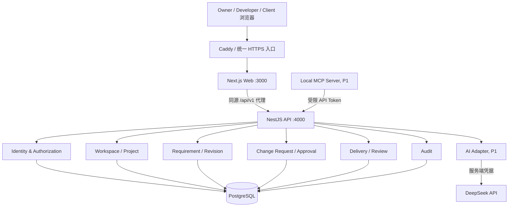

# SpecBridge 系统架构设计（Architecture Baseline）

> v0.2：产品 P0 决策确认；实施待验证｜2026-11-01｜设计基线，不表示代码已实现。以已完成的 WSL2/pnpm/Next/Nest/Postgres/DeepSeek 环境为前提。

## 1. 架构目标

- 满足 PRD 的三角色、项目隔离、需求版本、双方审批和交付验收；保证核心操作一致性。
- 两周完成可上线 MVP：**模块化单体（Modular Monolith）+ REST API + 单 PostgreSQL**。
- 对前端、AI 运行时和 MCP 暴露稳定、授权的业务 API，不在客户端或 MCP 中复制业务规则。
- 部署简洁，测试和回滚可操作；不为了“技术先进”引入微服务/Kafka/Redis/Kubernetes。

## 2. 技术栈（预定，精确版本以仓库 lockfile 为准）

| 层 | 组件 | 责任 |
|---|---|---|
| Web | Next.js App Router / React / TypeScript | 页面路由、表单、交互、用户态呈现 |
| UI | Tailwind、shadcn/ui、TanStack Query、Zod | 界面、请求状态、前端输入校验 |
| API | NestJS / REST / OpenAPI | 所有业务状态机、授权、校验与响应契约 |
| 数据访问 | Drizzle ORM、pg | SQL Schema、事务、迁移与查询 |
| 数据库 | PostgreSQL 17 | 持久化、唯一约束、乐观并发、审计 |
| AI | DeepSeek via Provider Adapter | 结构化需求建议，结果只作草稿 |
| Agent（P1） | MCP Server stdio + Skill | 在权限约束内读取已批准需求 |
| DevOps | pnpm workspace、Docker Compose、GitHub Actions | 一致环境与持续质量检查 |
| 发布 | Linux VPS + Docker Compose + Caddy（拟定） | 统一 HTTPS 入口、Web/API、持久化 DB |

## 3. 逻辑拓扑



**信任边界**：浏览器、外部 LLM、MCP Client、GitHub Issue URL 都是不可信输入来源；鉴权/授权/版本校验/事务只在 NestJS 中完成。MCP **不能直连 DB**。生产反向代理与内部服务只暴露必要端口；数据库仅内部网络可达。

## 4. 后端模块划分

| 模块 | 所有权/功能 | 依赖 |
|---|---|---|
| `auth` | 注册、密码、Session、当前身份 | users/sessions |
| `workspaces` | 工作空间、Owner/Developer | auth |
| `projects` | 项目、初始范围、成员和客户审批人 | workspaces/auth |
| `requirements` | Requirement、Clarification、不可变 Revision | projects |
| `changes` | ChangeRequest、不可变提交快照、状态机 | requirements/projects |
| `approvals` | 供应方/客户决策、唯一约束、并发处理 | changes/auth |
| `deliveries` | 提交、退回、验收 | changes/projects |
| `audit` | 关键业务事件，按项目授权查询 | all application services |
| `ai`（P1） | DeepSeek 调用、Schema 校验、超时 | requirements |
| `integrations`（P1） | Scoped API tokens、MCP 工具映射 | authorization |

各模块的 Controller 不直接访问其他模块数据库表；通过 Application Service 的公共契约协作。跨模块事务由拥有业务用例的服务编排，不拆分成远程微服务。

## 5. 模块内部层次

```text
src/modules/changes/
  changes.controller.ts      HTTP输入/输出，DTO、授权 Guard
  changes.service.ts         业务用例，权限检查与事务编排
  changes.policy.ts          状态转移规则/角色决策（可单测）
  changes.repository.ts      DB 查询/更新，事务适配
  dto/                       Zod/DTO 请求响应校验
```

禁止从 Next.js Server Action 直接访问 PostgreSQL。Web 只能通过 API 契约操作正式业务资源。

## 6. 四条关键数据流

### A. 登录

浏览器提交邮箱和密码 → Nest Auth 验证哈希 → 生成高熵随机 Session Token → 数据库存 Token 哈希、过期时间 → 设置 HttpOnly Cookie → `GET /me` 检索身份与可见 Workspace/Project；退出时撤销会话。

### B. 需求澄清与版本

Client 创建 Draft（原文保留）→ Developer 添加澄清问题 → Client 作答 → Developer 创建结构化 Revision（不修改旧记录）→ 满足条件标记 Requirement Ready。

### C. 双方批准（核心事务）

Developer 编辑 ChangeRequest Draft（完整评估字段）并提交 ChangeRequestVersion（不可变快照）→ 事务内 `WHERE lock_version = n AND status = expected` 条件更新 → 写 AuditEvent → Owner `VENDOR_APPROVE` → Client `CLIENT_APPROVE` → Approved。审批记录唯一键防重；过期写返回 409。任何重提交产生新版本，历史审批不继承。

### D. 交付与验收

Developer 提交 Delivery（URL + 说明 + 验证清单，关联 Approved CR version）→ Client 仅针对该 Delivery 提交 ACCEPT / CHANGES_REQUESTED → 审计记录。退回后再次交付产生新 Delivery，不删除旧记录。

## 7. Web 前端职责与页面

- Web 不做权限真实性判断，只根据 API 返回的能力展示可用操作；所有写入由服务器二次校验。
- 支持 `/login`、`/register`、Dashboard、Project、Requirement、ChangeRequest、Delivery 和成员管理。
- 表单对可用状态给出明确操作；出现 409 提醒刷新；模型失败单独呈现，不影响手动编辑。
- 客户仅看到自己获准访问的字段（内部备注不在 Client Response DTO 中暴露）。

## 8. 一致性与事务边界

- 单数据库事务中完成：条件状态变更、Approval/Review 记录、AuditEvent。
- 对 ChangeRequest 使用 `lock_version integer NOT NULL DEFAULT 0`；提交时要求 `If-Match`/`expectedVersion`，原子更新并自增。
- 关联不可变 ChangeRequestVersion，数据库在审批层实施 `(change_request_version_id, step)` 唯一约束；禁止同一版本重复决策。
- 只要无法保证事务提交成功，就不得对客户端报告操作完成。
- 外部 DeepSeek 调用**不放在事务内**；网络超时不锁住数据库事务。

## 9. 可观察性与错误处理

- API 统一 `{data: ...}` / `{error: {code, message, requestId}}`（细节见 API.md）。
- 结构化日志：requestId、method、route、status、latency、actorId（脱敏）；不记录 Cookie、Authorization、API Key、密码或完整敏感正文。
- 统一 HTTP：400 校验失败；401 未登录；403 无角色；404 不可见资源；409 状态/版本冲突；422 业务校验；429 限流；503 外部 AI 暂不可用。
- v1 仅保证基本日志和健康检查；如将来异步任务增加，再引入 Job 表或队列。

## 10. 部署视图与环境

**开发**：Next :3000、Nest :4000 运行于 WSL2，Docker Postgres 映射 `127.0.0.1:5433`。

**生产候选**：单 Linux VPS，Caddy HTTPS 反向代理；Web/API 内部容器网络；Postgres 非公开端口，Volume 持久化；数据库迁移作为受控发布步骤。镜像使用固定版本或 Digest，部署有备份及回滚说明。

## 11. 安全与故障设计

- 会话 Cookie、CSRF 防护、输入校验、对象级授权与速率限制见 `SECURITY.md`。
- URL 仅存储并显示为安全链接，不让服务端任意抓取用户提供的 URL，以规避 SSRF。
- AI 输出是**不可信建议**，必须 Schema 校验和人工确认；不得执行其中所谓“系统指令”。
- P1 MCP 默认只读 `list_project_requirements` 和 `get_approved_spec`，使用项目限定、可撤销 Token。
- 备份恢复演练实际验证；不能仅靠 Docker Volume 推断数据安全。

## 12. 设计待决

D-01 至 D-04 已确认，见 `DECISIONS_TO_CONFIRM.md`；任何改变已批准领域模型、权限或支付逻辑的建议必须先修订 PRD 与 ADR。


## 13. v0.2 决策落点（模块所有权）

1. `projects`：`baseline_scope` 创建时非空、不可修改；Client 由 Owner 通过独立服务绑定；在首次 Submit 前允许更正，提交后锁定身份。
2. `requirements`：创建 Revision 前检查本 Requirement 是否存在处于 `SUBMITTED` 或 `VENDOR_APPROVED` 的评估审批；避免冻结快照与沟通版本竞态。
3. `changes`：Draft 字段由变更服务管理，Submit 在事务内复制到不可变 Version，并检查项目唯一 Client、最新 Ready Revision。
4. `approvals`：Owner→Client 顺序、同一 VersionId、双身份不得重合，单事务写状态/决定/审计。
5. `deliveries`：只允许 HTTPS URL + 文本 + HTTPS 证据链接；一个 CR 版本同时最多一个待审交付；`ACCEPTED` 后不可再提交。
6. **业务边界**：初始范围是参考快照而非双方签署文件；v1 追踪正式 ChangeRequest 及其交付，不包含原始项目所有研发任务的看板。

细节状态图见 `docs/architecture/STATE_MACHINES.md`，实施以此与 API/数据模型共同校验。
