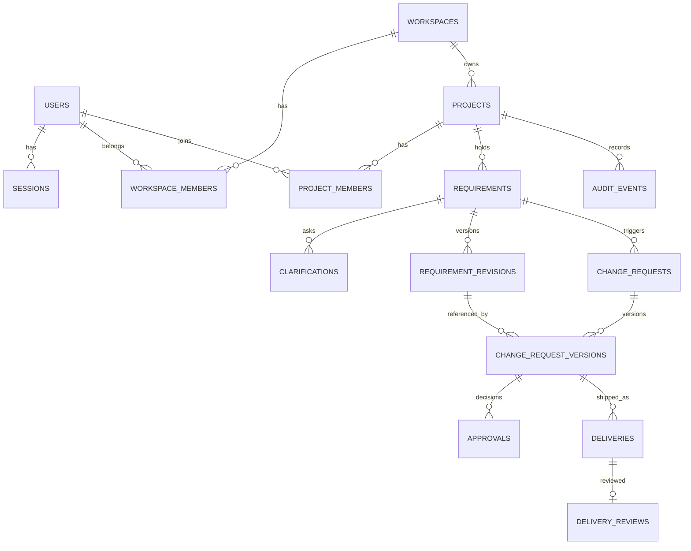

# SpecBridge 数据模型与约束（Data Model）

> v0.2 已确认业务基线；待实现；不是现存数据库迁移。PostgreSQL 17 + Drizzle ORM；所有主键 UUID；时间存 `timestamptz`（UTC），展示时本地化；字段遵循 `snake_case`。

## 1. ER 图（核心关系）



## 2. 表和字段（P0）

以下 `created_at` 默认 `now()`；`updated_at` 仅用于可变实体；非必要重复字段尽量由关系推导。`NOT NULL` 默认应用于主键、外键、状态和核心内容。

### 身份与组织

| 表 | 主字段 | 约束 / 索引 |
|---|---|---|
| `users` | `id uuid PK`, `email text`, `display_name text`, `password_hash text`, `created_at` | `unique(lower(email))`（R01 选择，无需 citext 扩展）；密码哈希不外发 |
| `sessions` | `id uuid PK`, `user_id FK`, `token_hash char(64)`, `expires_at`, `last_activity_at`, `revoked_at nullable`, `created_at` | `unique(token_hash)`，索引 `(user_id, expires_at)`；仅存哈希 |
| `workspaces` | `id uuid PK`, `name`, `owner_id FK users`, `created_at` | Owner 必须有效，工作空间主键是租户边界 |
| `workspace_members` | `id uuid PK`, `workspace_id FK`, `user_id FK`, `role enum OWNER/DEVELOPER`, `created_at` | 唯一 `(workspace_id,user_id)`；创建时在同一事务写入唯一 Owner 成员，`workspaces.owner_id` 与 Owner 成员必须一致 |

### 项目与需求

| 表 | 主字段 | 约束 / 索引 |
|---|---|---|
| `projects` | `id uuid PK`, `workspace_id FK`, `name`, `baseline_scope text NOT NULL`, `status enum ACTIVE/ARCHIVED`, `created_at` | index `(workspace_id,status)`；trim 后非空；仅 INSERT 时设置 baseline_scope，v1 无修改路径 |
| `project_members` | `id uuid PK`, `project_id FK`, `user_id FK`, `role enum DEVELOPER/CLIENT`, `created_at` | 唯一 `(project_id,user_id)`；`CLIENT` 在同项目最多一人（部分唯一索引）；首个正式提交前可空，之后不得替换 |
| `requirements` | `id uuid PK`, `project_id FK`, `created_by FK`, `title`, `original_text`, `status enum DRAFT/CLARIFYING/READY`, `latest_revision_id nullable`, `draft_version int NOT NULL DEFAULT 1`, `created_at`, `updated_at` | index `(project_id,status)`；外键/校验保证 `latest_revision_id` 属于本 Requirement |
| `clarifications` | `id uuid PK`, `requirement_id FK`, `author_id FK`, `parent_id nullable`, `kind enum QUESTION/ANSWER`, `body text`, `created_at` | index `(requirement_id,created_at)`；父项须同 Requirement |
| `requirement_revisions` | `id uuid PK`, `requirement_id FK`, `revision_no int`, `content text`, `acceptance_criteria jsonb`, `created_by FK`, `created_at` | 唯一 `(requirement_id,revision_no)`；R01 采用数据库触发器拒绝 UPDATE/DELETE，已在 R01 隔离 PostgreSQL 集成测试验证 |

### 变更、审批、交付

| 表 | 主字段 | 约束 / 索引 |
|---|---|---|
| `change_requests` | `id uuid PK`, `requirement_id FK`, `status enum DRAFT/SUBMITTED/VENDOR_APPROVED/APPROVED/REJECTED`, `lock_version int`, `active_version_id nullable`, `draft_requirement_revision_id FK`, `draft_scope_summary text`, `draft_estimate_hours numeric(8,2)`, `draft_cost_delta_minor bigint`, `draft_currency char(3)`, `draft_schedule_delta_days int`, `draft_acceptance_criteria jsonb`, `created_by FK`, `created_at`, `updated_at` | index `(requirement_id,status)`；`lock_version>=0`；草稿字段仅 DRAFT 可改，Submit 复制到不可变 Version |
| `change_request_versions` | `id uuid PK`, `change_request_id FK`, `version_no int`, `requirement_revision_id FK`, `scope_snapshot text`, `estimate_hours numeric(8,2)`, `cost_delta_minor bigint`, `currency char(3)`, `schedule_delta_days int`, `acceptance_criteria jsonb`, `submitted_at`, `submitted_by FK` | unique `(change_request_id,version_no)`；工时≥0、金额可正负、币种 ISO 代码；不可改快照 |
| `approvals` | `id uuid PK`, `change_request_version_id FK`, `step enum VENDOR/CLIENT`, `actor_id FK`, `decision enum APPROVED/REJECTED`, `comment nullable`, `created_at` | 唯一 `(change_request_version_id,step)`；不允许同阶段重复决策；权限由服务端校验 |
| `deliveries` | `id uuid PK`, `change_request_version_id FK`, `delivery_no int`, `artifact_url text`, `summary text`, `evidence_links jsonb`, `status enum SUBMITTED/CHANGES_REQUESTED/ACCEPTED`, `created_by FK`, `created_at` | unique `(change_request_version_id,delivery_no)`；`artifact_url`/证据链接 HTTPS；同 CR 版本最多 1 条 SUBMITTED，ACCEPTED 后禁止继续交付 |
| `delivery_reviews` | `id uuid PK`, `delivery_id FK UNIQUE`, `reviewer_id FK`, `decision enum ACCEPTED/CHANGES_REQUESTED`, `comment nullable`, `created_at` | 每次 Delivery 仅一条最终审查结果，退回后新建 Delivery |
| `audit_events` | `id uuid PK`, `workspace_id FK`, `project_id FK nullable`, `actor_id FK nullable`, `event_type`, `entity_type`, `entity_id`, `entity_version nullable`, `metadata jsonb`, `created_at` | index `(project_id,created_at desc)`；元信息最小化，不存密钥 |

> 重要：`latest_revision_id` 与 `active_version_id` 是缓存式快捷引用，必须在事务中保证归属与版本一致。若实施复杂，MVP 可不存它们，通过 `(revision_no/version_no) DESC` 查最新版本，降低跨表不变量数量。

> R01 已确认澄清：`draft_requirement_revision_id` 必填，其余商业评估 `draft_*` 字段允许 NULL，表示尚未填写。不得用默认 0/空字符串冒充已评估。Submit 必须在领域事务内检查完整性，`change_request_versions` 的对应字段全部必填。此澄清与 API-21/23 先创建 Draft 再填写评估的流程一致。

## 3. 数据完整性与安全边界

1. 所有服务端查询先检查**当前用户是否有权访问所属 workspace/project**；对动态 URL 资源不只校验角色名称。
2. 客户账号只能通过 `project_members(role=CLIENT)` 访问其项目。每项目唯一客户审批人通过部分唯一索引确保，例如 `UNIQUE(project_id) WHERE role='CLIENT'`。
3. Workspace Owner 管理自己 Workspace 项目；Developer 需要同时满足供应方身份与项目分配；Client 不自动成为 Workspace Member。
4. `change_request_versions` 的 `requirement_revision_id` 必须属于该 ChangeRequest 的 Requirement，应用服务在同一事务校验。
5. `deliveries` 的 CR 版本必须确实 Approved，数据库条件写 + 服务端事务校验。Client 只能对自己项目的 Delivery 审查。
6. 审批/交付审查仅 INSERT，不覆盖历史；变更版本冻结后不可 UPDATE。建议对高风险写入在 repository 层建立禁止更新入口，并写集成测试；数据库触发器属于可选强化项。
7. 采用 `ON DELETE RESTRICT` 或软归档，避免删除项目时级联抹掉审计证据；不提供普通用户物理删除审批/审计的操作。
8. 数据库连接使用最小权限凭据；生产迁移用户可与运行时用户分开（条件允许时）。

## 4. 事务/并发方案

### 提交审批示例（伪 SQL）

```sql
BEGIN;
UPDATE change_requests
SET status = 'VENDOR_APPROVED', lock_version = lock_version + 1
WHERE id = :id AND status = 'SUBMITTED' AND lock_version = :expected_lock_version;
-- 必须恰好影响 1 行；否则 ROLLBACK -> 409
INSERT INTO approvals(change_request_version_id, step, actor_id, decision, ...)
VALUES (:frozen_version_id, 'VENDOR', :owner_id, 'APPROVED', ...);
INSERT INTO audit_events(...) VALUES (...);
COMMIT;
```

真实实现需先检查角色、Project 归属和版本有效性；数据库 unique 防止重复插入。重复调用默认返回 409（或使用幂等键返回已确定结果；两周 MVP 选择前者）。

### 重新提交

旧 Version 被拒绝后可编辑 ChangeRequest 草稿；重新提交时创建 `version_no + 1`，状态重设 `SUBMITTED`。旧版本 `approvals` 继续保留，但新版本需要重新完成 VENDOR/CLIENT 审批。

## 5. Schema 迁移策略

- 先 Schema Review，再通过 `drizzle-kit generate` 生成 SQL；审查 SQL 后 `migrate`，迁移文件与 schema 一起提交。
- 不使用生产环境的 `push` 自动重建或删表；迁移前备份，升级时保留版本与可恢复计划。
- 本地演示 Seed 数据使用独立脚本，显著标记 `demo`，不含真实客户资料、真实密码或 API Key。

## 6. P1 增量实体

- `ai_analysis_runs`：`id`, `requirement_id`, `requested_by`, `status`, `model`, `input_revision_id`, `output_json`, `error_code`, `created_at`，不存明文密钥；可以在 P1 实施时增加。
- `api_tokens`：`id`, `user_id`, `project_id`, `token_hash`, `scopes`, `expires_at`, `revoked_at`；仅 MCP 只读 Token，支持撤销与审计。
- `external_links`：已批准版本与 GitHub Issue URL 对应，**不自动抓取 URL**。

## 7. 未定与简化方案

- `baseline_scope` 已确认只作创建时固定的参考快照，不提供双方初始签认；如需要 ProjectScopeVersion/Approval，将作为后续版本的独立需求处理。
- 是否允许负数费用变更：默认可正/负/零以支持范围缩减；若产品希望只记录新增费用可改限制。
- 多币种按变更记录单一币种；不做自动汇率换算。

## 8. v0.2 强制的额外数据约束

1. **Client：0→1 时点**：创建项目可为 0，首次 Submit 必须为 1；部分唯一索引保证不能超过 1。禁止在发生正式 Submit 后更换，不能依赖前端隐藏按钮。
2. **供应方/客户职责分离**：项目 Client 账号不可同时作为同一 Workspace 的 Owner/Developer；显式 Project Developer 必须是该 Workspace 的 Developer 成员；Owner 通过所有权访问全部项目，不重复分配为 Project Developer。
3. **Draft→Version 映射**：`change_requests.draft_*` 是可编辑字段，`change_request_versions` 是 Submit 时复制的不可变字段；在事务中校验完整性、最新 Ready Revision 和唯一 Client。
4. **Revision 审批冲突**：同一 Requirement 存在任一 `SUBMITTED`/`VENDOR_APPROVED` 的 ChangeRequest 时禁止新增 Revision；已完成/拒绝后可新增，不改变旧 Approval/Delivery。
5. **交付串行性**：`deliveries` 增加部分唯一索引 `UNIQUE (change_request_version_id) WHERE status='SUBMITTED'`；同一 CRVersion 已有 Accepted 交付时不能再创建；`delivery_no` 在事务内递增。
6. **字段可见性**：正式商业快照里的范围、工时、费用、工期、验收标准均对本项目唯一 Client 可见；v1 不含额外“内部备注”业务字段。
7. **不可变性实现**：历史 Revision/CRVersion/Approval/DeliveryReview 仅创建/读取，无公开更新/删除服务；必要时用受限数据库角色或触发器补强，至少有集成测试防回写。
8. **所有权一致性**：`workspaces.owner_id` 与 `workspace_members(role=OWNER)` 在同一事务创建并保持一致；禁止转移 Owner（v1）。
9. **唯一性和并发**：至少数据库唯一键保证一个项目同一时点只有一位 Client；事务中的状态条件更新防止两个审查/提交并发绕过约束。

> 约束 #1、#2、#4、#6 需要跨表验证，不能仅靠 CHECK 完成；依赖事务和集成测试，或明确的触发器。

## 9. R01 实现选择与验证边界

2026-11-08：负责人已批准两份 SQL；在隔离 PostgreSQL 17.11 上完成空库/重复迁移与 10 项集成测试。生产与现有开发库未迁移；本机网络绕行方式、运行证据及远程 CI 状态以 `../STATE.md` 为准。

- 保留 latest/active 缓存指针，通过复合外键保证父对象归属；澄清父项同 Requirement、审计 Project 同 Workspace 也用复合外键。缓存是否为最新版本仍须领域事务保证。
- 全部外键采用 `ON DELETE RESTRICT`；UUID 默认生成，时间为 `timestamptz`。`updated_at` 由可变实体写入操作显式更新。
- 部分唯一索引限制每项目最多一名 Client、每 Workspace 最多一名 Owner 成员、每 CRVersion 最多一条 SUBMITTED Delivery。它们不保证存在性、角色分离或合法状态迁移。
- Revision/CRVersion/Approval/DeliveryReview 的 UPDATE/DELETE 由自定义迁移触发器拒绝；初始范围只在值实际变化时拒绝更新。触发器不在 Drizzle snapshot 内，必须连同自定义 SQL 审核；数据库管理员仍可禁用触发器，不作为管理员防篡改机制。
- `numeric(8,2)` 在应用内保留精确字符串，`bigint` 使用 JS bigint。未来 HTTP 层需明确安全整数边界/序列化，不能直接将 bigint 放入 JSON 响应。
- DB 对币种检查三位大写格式，对链接检查 HTTPS 基本形态；完整 ISO 币种和 URL 解析属于后续输入校验。JSON 验收标准为字符串数组；Revision 可以为空数组，READY 必须非空由服务验证；冻结 Version 必须非空数组。
- R01 不实现认证、业务 API、RLS、生产角色配置或自动迁移。不能把结构约束测试当作授权/审批流程验收。

### 后续事务责任

| 规则 | 必须统一协调的入口 |
|---|---|
| `owner_id` 与唯一 Owner 成员一致、供应方/Client 职责分离 | Workspace 创建、所有成员分配/身份变化；锁 Workspace 后校验 |
| Submit 时存在 Client，首次提交后不可更换 | Submit 与 Client 分配均锁 Project；通过历史 Version 判断是否曾提交 |
| READY/最新 Revision、Pending 审批阻止新 Revision | Submit 与 Revision 创建均锁 Requirement；检查所有待审批 CR |
| CR 的 Revision 归属、两阶段审批、active Version 匹配 | CR 领域服务验证父链和身份，条件更新 lock_version，与 Approval/Audit 同事务 |
| Approved 后交付、Accepted 后禁止新交付 | 创建/审查统一锁关联 CR，检查精确 Version，事务内分配 delivery_no |
| 业务记录和审计一致 | 同一 transaction 对象内写入；任何失败整体回滚 |

锁顺序统一为 Workspace → Project → Requirement → CR，仅取得操作需要的锁；禁止另一个入口采用相反顺序。真实业务并发/越权测试在对应 Issue 实现。

### 已识别、经负责人确认延后的契约缺口

- R01 延后的 Requirement 并发字段已在 R04 计划明确为 draft_version；新增 0003 SQL 已人工批准并在隔离测试实例应用，见下节。
- Session 空闲失效在 R02 明确：新增 0002_session_activity.sql 添加 last_activity_at timestamptz NOT NULL DEFAULT now()；旧记录回填 created_at，保留原会话年龄。expires_at 仅表示 7 天绝对期限，last_activity_at 表示 24 小时空闲期限。新增 SQL 审核/验证状态见 STATE.md；R01 0000/0001 不改动。

## R03 领域事务落实

- 无新增 Schema/Migration，0000–0002 不变。Owner 成员存在性及与 owner_id 一致由创建事务保证；唯一索引仅保证最多一人。
- Workspace Developer 添加、Project 创建/成员分配均锁 Workspace；项目成员及 Client 写再锁 Project。先锁后重新校验授权，统一 Workspace → Project → Requirement → CR 顺序。
- 绑定 Client 检查 owner_id 和 Workspace membership；反向添加供应方成员检查本空间所有项目的 Client。两入口共享 Workspace 锁，防止并发双角色。
- Client 更正使用单事务删除旧 CLIENT + 插入新 CLIENT + 审计；部分唯一索引兜底。相同绑定重复请求无修改/无审计；未提交前不同账号请求按事务串行处理。
- 首次提交锁定通过 Project → Requirement → CR → 任意历史 Version 存在性判断，不加布尔列。未来 Submit 必须先锁 Project 再校验 Client、创建 Version；R03 用结构 fixture 验证锁协议，非完整 Submit 实现。
- 审计包含 workspace.created、workspace.developer_added、project.created、project.developer_added、project.client_bound/replaced；同一 transaction 写入，metadata 仅相关身份 ID/角色，不包含邮箱、baseline 正文或认证凭据。
- 无 RLS/数据库级跨表角色触发器；任意直接 SQL 不在应用 RBAC 保证内。读取时对 Owner 不一致、请求者的供应方/Client 冲突默认拒绝。


## R04 增量实现与迁移

- 新增 requirements.draft_version integer NOT NULL DEFAULT 1，CHECK > 0；既有行从 1 开始，不推算历史编辑次数。0000–0002 SQL/snapshot 保持不变。0003 已获人工批准，并通过隔离 PostgreSQL 存量升级及回归测试；执行证据见 STATE 与 HUMAN_TASKS。
- draft_version 是 Requirement 聚合版本，包含草稿、问答、Revision 和 Ready 写入；与 revision_no 分离。条件 UPDATE 同时匹配 id/版本，并显式更新 updated_at。
- Revision 在 Requirement 锁内按 MAX(revision_no)+1 分配；插入、最新指针、CLARIFYING 状态、聚合版本及审计同事务，回滚不消耗编号。
- R04 写锁统一 Workspace → Project → Requirement（创建需求锁到 Project）；READ COMMITTED，FOR UPDATE，获得锁后重新用 Project Policy 授权。Client 不通过要求供应方 membership 的 Workspace Policy 校验。
- 未来 Submit 延续 Workspace → Project → Requirement → CR 锁序，同事务验证唯一 Client、最新 Ready Revision 和 CR 版本。Revision 查询同需求全部 SUBMITTED/VENDOR_APPROVED CR；双方共锁 Requirement 防止检查后新增 Pending。不可先锁 CR 再回锁父项。
- 问答父项必须是同需求 QUESTION，由领域服务校验；已有复合外键仅保证归属。问答追加共享 Requirement 锁，R04 不提供问答改删；历史 Revision 保留数据库不可变触发器。
- 多查询读取使用只读 REPEATABLE READ 快照，避免授权与投影跨越 Client 更正。AuditWriter 复用同一 tx，扩展事件/版本类型，任何业务或审计失败整体回滚。
