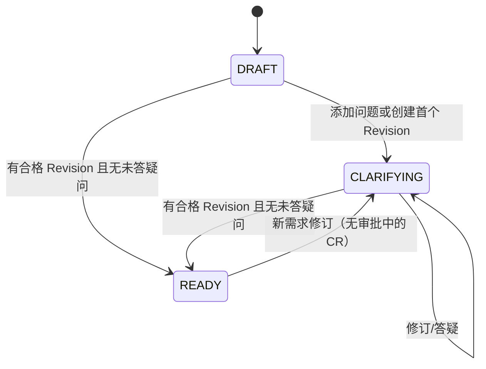
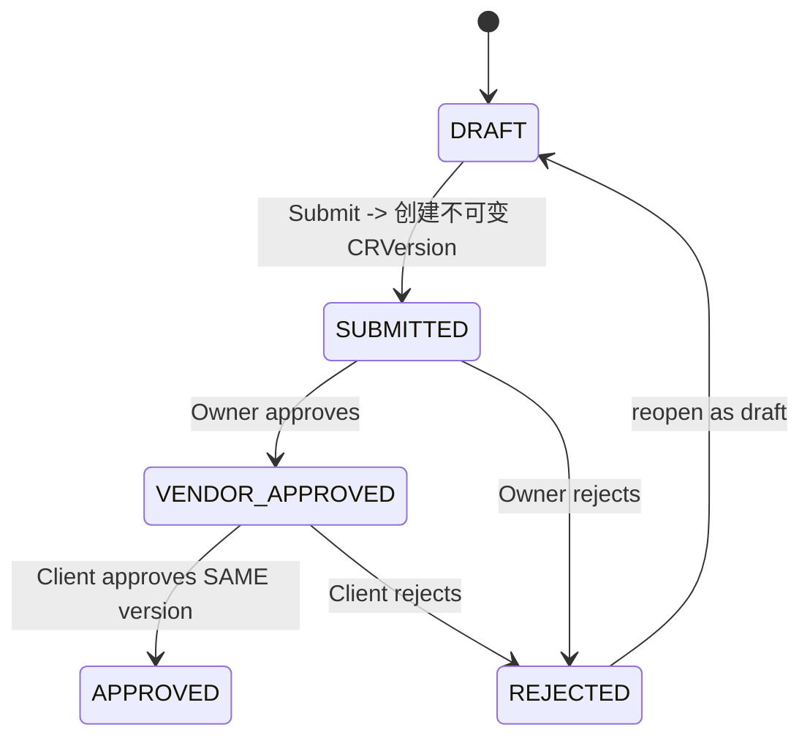
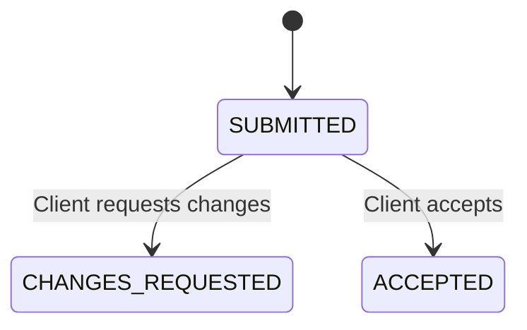

# SpecBridge 核心状态机与不变量（v0.2）

> 产品负责人 2026-11-01 确认 D-01～D-04。本文件为目标设计，不代表已实现。

## 0. 跨对象不变量

- Project 创建时可无 Client；首次 `ChangeRequest.submit` 必须存在**唯一**、已注册、与供应方职责分离的 Client。此后 v1 不支持更换。
- `baseline_scope` 为不可修改的初始范围参考，**非双方法律签署**；不提供“初始范围批准”状态机。
- `RequirementRevision` 与 `ChangeRequestVersion` 只读，所有审批与交付均绑定其具体主键。
- P0 只追踪通过 CR 正式确认的交付；原始范围的日常任务管理不在产品内。

## 1. Requirement

- `DRAFT` 原始需求可被原作者/Owner 编辑；已生成 Revision 不可修改。
- `READY` 需要至少一个有效 Revision、非空验收标准、未解决的必答问题均有答复。MVP 用是否存在 Answer 作为判断，若需要更复杂的“澄清已解决”语义应新增状态字段。
- 同 Requirement 存在 `SUBMITTED` / `VENDOR_APPROVED` 的 CR 时，新 Revision 返回 `409 REVIEW_IN_PROGRESS`。旧的 Approved 版本不变；待审批结束后可以创建新 Revision 和新 CR。
- 新 Revision 创建后状态回到 CLARIFYING，必须重新标记 READY；不能未经确认直接自动批准。

### R04 实施细化（本地验证完成）

- 所有 QUESTION 均为必答；存在同需求、以该 QUESTION 为 parent 的合法 ANSWER 即已答。不新增 required/resolved 字段，不要求额外 Resolve 动作；允许多个追加回答，无编辑/删除问答接口。
- READY 禁止追加问题和回答；须先创建新 Revision 回到 CLARIFYING。Client 不能通过问答使 Ready 失效。
- 创建首个 Revision 同样进入 CLARIFYING；每次 Revision 均需重新 Ready。Ready 只确认最新指针且必须是最高 revisionNo，无独立 readyRevisionId。
- Revision 的已澄清结论由供应方整理进 content；不新增问答快照关系，不将后续问答解释为旧 Revision 内容。
- 只有 DRAFT 原作者/Owner 可 PATCH；CLARIFYING 中可追加问题/回答。所有已有需求写操作携带 expectedVersion，并推进同一 draftVersion，防止旧页面确认新内容。

## 2. ChangeRequest

- 草稿具有完整 `draft_*` 评估字段；Submit 校验全部必填字段、项目唯一 Client、最新 READY 需求 Revision，并事务复制成新的 `ChangeRequestVersion`。
- 只有 Owner 能做 VENDOR 阶段决定；只有已绑定的 Client 能做 CLIENT 决定。
- 决定唯一键 `(change_request_version_id, step)`；锁版本必须匹配；原子修改状态 + 写 Approval + AuditEvent。
- 拒绝时保存历史 Version 和决定；`resubmit` 回到 DRAFT，下一次 Submit 增加 version_no，Owner/Client 必须重审。
- APPROVED 为该 CR 的终态；后续变动创建新的 RequirementRevision + 新 ChangeRequest，不覆盖原审批。

## 3. Delivery

- 仅可为 APPROVED CRVersion 创建交付；只有该项目唯一 Client 能对 SUBMITTED Delivery 审查。
- 客户要求修改后**旧 Delivery 保持 CHANGES_REQUESTED**，开发者为**同一 Approved CRVersion**新建 `delivery_no + 1`。
- 同一 Approved CRVersion 同时只能存在一个 `SUBMITTED` Delivery；如果有 `ACCEPTED`，不再接受新交付。
- 每个 Delivery 最多一条 DeliveryReview；拒收时必须包含非空评论；Review 与状态、审计在事务内完成。
- `artifactUrl` 必须为 HTTPS；`evidenceLinks` 是可选 HTTPS URL 数组；不上传文件或抓取任意 URL。

## 4. 错误与测试

| 触发 | 错误 | 最低测试 |
|---|---|---|
| 未绑定 Client 进行 Submit | 422 CLIENT_REQUIRED | 创建项目后直接提交，断言无 Version |
| 首次 Submit 后更换 Client | 409 CLIENT_ASSIGNMENT_LOCKED | Client 不变、审计不变 |
| 同项目第二 Client / 供应方 Client | 409/422 | 唯一索引及角色检查 |
| 处于审批中的 Requirement 新 Revision | 409 REVIEW_IN_PROGRESS | 旧 Revision/Version 不变 |
| 同版本重复/竞态批准 | 409 STALE_VERSION / ALREADY_REVIEWED | 并发数据库集成测试 |
| Client 先于 Owner 批准 | 409 INVALID_TRANSITION | Approval 不写入 |
| 未批准版本交付 | 409 INVALID_TRANSITION | Delivery 不写入 |
| 重复待验收交付 / 已验收后交付 | 409 DELIVERY_PENDING / DELIVERY_COMPLETED | 数量和状态不变 |
| 非当前项目账号审批/验收 | 403/404 | 无泄露、无副作用 |

未记录的非法状态转移默认拒绝；所有状态变更由 NestJS 领域服务统一实现。

## R05 实施细化

- CR 初始 lockVersion=0；所有已有 CR 写操作携带非负 expectedVersion，成功递增一次，失败零副作用；Requirement draftVersion 独立。
- resubmit 只是 REJECTED→DRAFT，保留旧 activeVersionId/商业值；DRAFT 不能审批，下一次 Submit 才生成新 Version。旧 Revision 非最新 Ready 时必须 PATCH 显式选择新 Revision。
- APPROVED 终态不能 PATCH/resubmit；新增范围用新 Revision、新 CR。多个 CR 可以引用同一 Ready Revision，任何一个 Pending 都阻止新 Revision。
- CRVersion 本身没有可变 status；历史拒绝/批准由其 Approval 决定记录表示。Client 决定必须验证 active Version 是最新、归属正确且有同 Version 的 Owner APPROVED。
- 先判 stale，再判已有决定/合法阶段；同一预期版本竞争一成功一 STALE_VERSION，刷新后重复已决定步骤 ALREADY_REVIEWED。Client 先到时 INVALID_TRANSITION；等待 Owner 提交后旧 expectedVersion 为 STALE_VERSION，不自动批准新状态。
