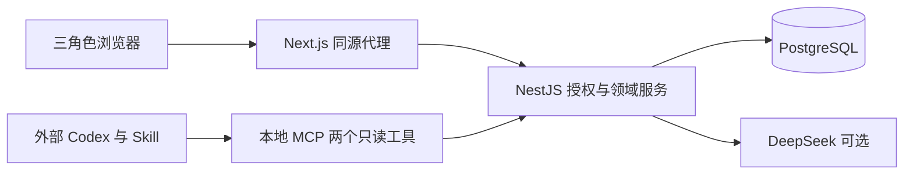

# SpecBridge 项目与开发流程演示

[文档中心](../README.md) · [运行指南](GETTING_STARTED.md) · [使用指南](USER_GUIDE.md)

面向老师的讲解稿与操作脚本。正文约 8–10 分钟；完整功能演示预留 40–60 分钟，可提前完成账号注册和环境准备。所有案例均为合成数据。正文讲设计与工程，后半部分按顺序操作终端、文件、GitHub 和网站。

## 一 项目解决什么问题

SpecBridge 面向独立开发者和 2–10 人软件工作室，解决“需求说不清、变更没有明确确认、交付缺少验收依据”的协作问题。这些痛点来自产品假设，尚不能当作真实用户调研结论。

以“客户想增加报表导出”为例：客户先提出需求，开发者澄清并整理规格，评估范围、费用与工期；供应方负责人和客户依次批准同一冻结版本，再按该版本交付验收。拒绝后重新提交新版本，交付退回后新增交付记录，保留原历史。

```text
客户需求 → 澄清问答 → 不可变规格 Revision → 人工标记 Ready
→ 商业评估草稿 → Submit 冻结版本 → Owner 批准 → Client 批准
→ HTTPS 链接交付 → Client 验收 → 版本与审计可追溯
```

一个项目最多一名客户审批人；正式提交前必须绑定，首次提交后锁定。初始范围是固定参考，不等于合同签署。AI 帮助整理信息，商业批准与验收始终由人完成。

## 二 技术选择与工程基础

| 选择                                | 用途与原因                                                            |
| ----------------------------------- | --------------------------------------------------------------------- |
| pnpm Monorepo、TypeScript           | 统一维护 Web、API、MCP；根锁文件固定依赖，类型检查提前发现契约错误    |
| Next.js、React、Tailwind、shadcn/ui | 页面、表单和响应式交互；TanStack Query 管理请求状态，复用组件保持一致 |
| NestJS 模块化单体                   | 按认证、需求、变更、交付等分模块；统一授权和事务，适合小团队维护      |
| PostgreSQL 17、Drizzle              | 关系约束、事务、行锁与版本号保证一致性；SQL 迁移可审查、可追踪        |
| DeepSeek Adapter、Zod               | 模型调用留在服务端；结构化输出必须校验，可配置、可关闭                |
| MCP stdio、Agent Skill              | 外部助手通过受限 API 读取批准规格；Skill 规定分析步骤和引用要求       |
| Vitest、Playwright、GitHub Actions  | 单元、数据库、HTTP、浏览器分层验证；普通 CI 使用模型 Mock             |



权限由 API 决定；前端按钮只帮助操作。审批记录、状态和审计在同一事务写入；冻结版本不能覆盖，过期修改返回 409。选择模块化单体的理由见 [ADR-001](../adr/ADR-001-modular-monolith.md)，版本策略见 [ADR-003](../adr/ADR-003-versioned-approval.md)。

## 三 从需求文档走到代码

按下面顺序打开文件，每份只展示一个重点：

| 文件                                                                                                                            | 讲解重点                                                    |
| ------------------------------------------------------------------------------------------------------------------------------- | ----------------------------------------------------------- |
| [PRD](../product/PRD.md)、[用户故事](../product/USER_STORIES.md)                                                                | 目标用户、P0/P1、角色任务和范围外事项                       |
| [DECISIONS](../product/DECISIONS.md)、[ACCEPTANCE](../product/ACCEPTANCE.md)                                                    | D-03 确定先 Owner 后 Client；AC-10/11/12 把它变成可验证结果 |
| [架构](../architecture/ARCHITECTURE.md)、[数据模型](../architecture/DATA_MODEL.md)、[状态机](../architecture/STATE_MACHINES.md) | 服务边界、实体关系、允许和拒绝的状态转换                    |
| [API](../architecture/API.md)、[安全](../architecture/SECURITY.md)、[线框](../ux/WIREFRAMES.md)                                 | 请求契约、对象级权限、三角色操作入口                        |
| [ADR-004](../adr/ADR-004-ai-mcp-boundary.md)、[AI 增量计划](../engineering/AI_WORKFLOW_PLAN.md)                                 | 保留决策原因；D-09 批准后增加背景资料、工作稿与人工确认提案 |

可展示的追踪链：`US-08/09 → AC-10/11/12 → Issue #11 → changes.service.ts → changes.e2e-spec.ts → PR #12`。文档不仅描述功能，也约束实现和测试。

| 目录或文件                                       | 实际职责                                            |
| ------------------------------------------------ | --------------------------------------------------- |
| `apps/web/src/app`、`src/features`               | 页面路由与业务交互                                  |
| `apps/api/src`、`apps/api/drizzle`               | Controller、Service、Repository、Schema 与 SQL 迁移 |
| `apps/mcp/src`、`skills/requirement-analyst`     | MCP 工具、本地安装器、需求分析 Skill                |
| `apps/api/test`、`apps/web/e2e`、`apps/mcp/test` | 数据库/HTTP、浏览器、协议与安装测试                 |
| `infra`、`scripts`、根 `package.json`            | Compose、环境包装、检查与统一命令                   |
| `.github`、`AGENTS.md`、`docs/STATE.md`          | Issue/PR/CI 模板、Agent 规范、跨会话交接            |

## 四 分阶段开发与 Git 证据

[ROADMAP](../product/ROADMAP.md) 是计划；下面是当前 Git 中的实际节点。R 编号代表工程阶段，不代表每一阶段都单独部署。

| 阶段          | 内容与实现重点                                                     | 可查看的提交                                                            |
| ------------- | ------------------------------------------------------------------ | ----------------------------------------------------------------------- |
| 基线、R00–R01 | 需求/架构文档、工程脚手架、健康检查、数据库约束                    | `5f147e0`、`c64eb44`、`43343d3`                                         |
| R02–R03       | 数据库 Session、工作空间和项目授权、角色隔离                       | `8b89880`、`e80e657`                                                    |
| R04–R06       | 澄清与不可变修订、冻结评估、顺序审批、交付退回与验收               | `06ce706`、`ad7c37d`、`63d81aa`                                         |
| R07           | 三角色 Web、真实待办、历史/审计、生成 API 类型                     | `9d43f8f`                                                               |
| R08           | DeepSeek、人工采用、Copilot、Token、MCP/Skill                      | `6bfe681` 至 `922eef1`                                                  |
| AI 升级 A–E   | 个人稿、资料版本、确认提案、安装授权、综合回归；再做视觉与缺陷修复 | [PR #18](https://github.com/lithuio/specbridge/pull/18)，合并 `0a5eb0a` |

规范流程是：**分阶段 → Issue 关联 US/AC → 功能分支 → Codex `/plan` → 审阅计划 → 实现与测试 → Diff/Review → PR → CI → 人工合并 → 更新交接**。命令模板见后文 D2。

2026-11-13 核对时，[Issue #17](https://github.com/lithuio/specbridge/issues/17) 仍打开；[合并后 CI](https://github.com/lithuio/specbridge/actions/runs/43403007988) 的 `quality` 成功，`database` 在浏览器回归步骤失败。这是实际流程待补齐的地方，不能宣称全绿或正式发布完成。

## 五 重点介绍 AI 如何参与

1. **需求辅助**：分“帮我问清楚”和“帮我整理规格”；生成结果先校验，用户编辑、保存个人稿，再预览确认发布。保存稿不等于创建正式版本。
2. **项目背景**：解析 PDF/DOCX/Markdown/TXT，保留具体版本和页段来源；默认内部可见，对客生成只取明确共享资料。
3. **Copilot**：查询当前用户有权读取的项目事实并给出来源。提案支持发布问题、创建 Revision、创建/更新商业草稿；只有人确认才执行，金额和估算由人填写。
4. **外部 Agent**：Owner 授权本地连接，项目凭据可到期、可撤销；MCP 仅有列出批准规格和读取指定批准版本两个工具，不能读内部报价或执行审批。

实现时将“不可信内容”“模型建议”“正式业务命令”分开：Schema、超时和预算限制模型调用；服务端复核权限与来源；确认写入复用业务事务、版本冲突检查和执行回执。模型失败时可继续手动流程。DeepSeek 是产品内模型，Codex 是开发/外部分析助手，两者职责不同。

## 六 开发亮点与交接

亮点在于可追踪的需求、不可变批准历史、服务端授权、分层测试，以及受约束的 AI 工作流。Git 用功能分支和 Conventional Commit；Agent 先读 `AGENTS.md`、STATE、Issue 和相关契约，再按小阶段实现、报告真实测试结果。SQL、业务边界、合并和发布由负责人决定。

交接分别记录“规范、已完成证据、未决人工事项”：`docs/STATE.md` 接续开发，`docs/HUMAN_TASKS.md` 保留决定，阶段证据保存截图和验证结果。AGENTS/Skill 是协作指引，实际安全边界仍由 API、数据库和运行权限落实。

## 演示流程

以下 D0–D14 是完整排练顺序。勾选表示本次实际完成，不能预先把脚本当作验收结果。演示展示的是 SpecBridge 管理导出需求的能力，不声称本项目实现了客户门户的 CSV 导出业务。

### D0 会前准备与模拟资料

准备三个独立浏览器配置：Owner、Developer、Client。账号均先注册再登录，密码自行设置，不放进文档或投屏。每轮给项目加日期/轮次，避免和上次记录混淆。

| 项目      | 本轮输入                                                                                 |
| --------- | ---------------------------------------------------------------------------------------- |
| Owner     | `owner.demo@example.test`，显示名“林负责人”                                              |
| Developer | `dev.demo@example.test`，显示名“陈开发”                                                  |
| Client    | `client.demo@example.test`，显示名“王客户”                                               |
| Workspace | 青禾软件工作室                                                                           |
| 主项目    | 青禾客户门户 演示 01                                                                     |
| 初始范围  | 客户登录后查看本公司的月度报表；导出和邮件发送不在初始范围内。                           |
| 隔离项目  | 山岚内部项目；只由 Owner 访问，不分配上述 Developer/Client                               |
| 需求标题  | 按月导出本公司报表                                                                       |
| 原文      | 希望每月把本公司的报表导出来给财务核对。字段、格式、权限和没有数据时怎么办，还需要确认。 |

用终端创建合成背景文件；文件位于 `/tmp`，长期保留时自行复制到演示资料目录。

```bash
mkdir -p /tmp/specbridge-teacher-demo
cat > /tmp/specbridge-teacher-demo/client-v1.txt <<'EOF'
项目：青禾客户门户。
已有范围：客户登录后查看本公司的月度报表。
客户希望增加按月导出；字段、格式和空数据行为尚待确认。
任何导出只能包含当前客户有权访问的本公司数据。
邮件自动发送与跨公司汇总尚未批准。
EOF
cat > /tmp/specbridge-teacher-demo/client-v2.txt <<'EOF'
项目：青禾客户门户，背景修订第2版。
已有范围：客户登录后查看本公司的月度报表。
新增待澄清需求为按月导出，最终范围以双方批准版本为准。
背景补充：日期展示采用北京时间。
邮件自动发送与跨公司汇总尚未批准。
EOF
cat > /tmp/specbridge-teacher-demo/internal.txt <<'EOF'
内部讨论，仅供供应方参考。
内部备注标记：QH-INTERNAL-731。
尚未确定实际成本和人员排期，不应转成对客承诺。
EOF
```

提前打开 README、本文、PRD、AC、状态机、AGENTS、CI 文件和 PR #18。真实 AI 需已配置服务端密钥及调用额度；现场不展示 `.env`、Cookie、Token 或授权跳转参数。新机器安装和迁移按[运行指南](GETTING_STARTED.md)完成，课堂上无需临时初始化数据库。

### D1 启动与工程入口

在仓库根目录执行，已启动服务时跳过对应启动命令：

```bash
node --version
pnpm --version
bash scripts/check-workspace.sh
git status --short
unset DATABASE_URL NODE_ENV
pnpm db:up
```

```bash
# 终端 A：使用既有 .env 配置
unset DATABASE_URL NODE_ENV
pnpm dev:api
```

```bash
# 终端 B
pnpm dev:web
```

```bash
# 终端 C：分别检查 API 与 Web 代理
curl --noproxy '*' --max-time 10 -fsS http://localhost:4000/api/v1/health
curl --noproxy '*' --max-time 10 -fsS http://localhost:3000/api/v1/health
```

打开 `http://localhost:3000`。讲解：3000 是 Web，4000 是 API，开发库端口是 5433；健康检查不访问数据库，还要通过实际注册/登录验证数据库链路。本机当前基线 Node 为 22.23.4、pnpm 为 10.34.9。

常用命令对照：`pnpm install --frozen-lockfile` 安装；`pnpm dev:*` 开发热更新；`pnpm build` 构建；`pnpm lint` 静态检查；`pnpm test` API/MCP 测试；`pnpm test:browser` 完整浏览器测试。后两类不能混称同一种测试。测试命令详见 D13。

### D2 文档与开发历史演示

先按正文第三节展示文档，再运行只读命令：

```bash
git log --graph --oneline --decorate --all -25
git show --stat ad7c37d
git show --stat 3b371b0
git log --oneline -- apps/api/src/ai
gh issue view 11 --repo lithuio/specbridge
gh issue view 17 --repo lithuio/specbridge
gh pr view 18 --repo lithuio/specbridge
gh run view 43403007988 --repo lithuio/specbridge
```

`ad7c37d` 展示审批功能与测试一起提交；`3b371b0` 展示 Review 后修复背景替换上传的版本冲突，并增加回归测试。打开 [changes.service.ts](../../apps/api/src/changes/changes.service.ts)、[审批 HTTP 测试](../../apps/api/test/changes/changes.e2e-spec.ts) 和 [CI](../../.github/workflows/ci.yml)，解释“规则—实现—验证”。GitHub 不可用时展示本地提交与阶段证据，远端结果保持未重新核对状态。

下面是**下一次真实开发的操作模板，课堂展示时不执行远端写入，也不重复创建 #17**：

1. 在路线图中选一个小目标。按 [Issue 模板](../../.github/ISSUE_TEMPLATE/feature.yml) 写背景、范围、US/AC、依赖和测试，保存正文至 `/tmp/specbridge-issue.md`。
2. 真实开始任务时创建 Issue，记录返回编号；工作区干净后建立分支。

```bash
# 仅用于真实新任务；先完成上面的 Issue 正文
gh issue create --repo lithuio/specbridge \
  --title 'test(mcp): extend approved-spec regression' \
  --body-file /tmp/specbridge-issue.md
read -r -p '新 Issue 编号：' demo_issue
git switch main
git pull --ff-only origin main
git switch -c "test/${demo_issue}-approved-spec-regression"
codex
```

3. 在 Codex 交互界面输入 `/plan`，再给出以下提示；课堂回放可用“只分析 #17 已有实现，不修改文件”。

```text
阅读 AGENTS.md、docs/STATE.md、当前 Issue 与相关 AC/契约。
列出范围、预期修改文件、实现步骤和测试，包括跨项目拒绝、
未批准版本拒绝、Token 撤销，以及禁止审批工具的边界。
先给计划。不要读取密钥，不修改已批准业务基线。
```

4. 审阅计划后明确开始实现；保持小步变更，补充对应测试。完成后用 `git diff` 自查，Codex `/review` 或下面的 CLI 命令辅助审查，人工核对发现并修复。`/plan`、`/review` 是交互命令，不是 Bash 命令；用法见 [OpenAI 官方说明](https://learn.chatgpt.com/docs/developer-commands?surface=cli)。

```bash
git diff --stat
git diff --check
codex review --uncommitted
# 已提交分支相对 main 的审查用：codex review --base main
```

5. 运行适用检查后，按 [PR 模板](../../.github/PULL_REQUEST_TEMPLATE.md) 写 `/tmp/specbridge-pr.md`：包含实际 Issue 的 `Closes #编号`、行为变化、AC、真实测试结果和风险。只暂存已核对的文件，再提交和创建 PR。

```bash
# 将变量输入为本次实际修改路径；一次暂存一项，按需重复
read -r -p '本次文件路径：' demo_changed_file
git add -- "$demo_changed_file"
git diff --cached
git commit -m "test(mcp): extend approved-spec regression (#${demo_issue})"
git push -u origin "test/${demo_issue}-approved-spec-regression"
gh pr create --repo lithuio/specbridge --base main \
  --head "test/${demo_issue}-approved-spec-regression" \
  --title 'test(mcp): extend approved-spec regression' \
  --body-file /tmp/specbridge-pr.md
read -r -p '返回的 PR 编号：' demo_pr
gh pr checks "$demo_pr" --repo lithuio/specbridge --watch
```

6. CI 失败就修复并复验；CI 成功、Review 完成后才由负责人合并。经授权时可用 `gh pr merge "$demo_pr" --squash --delete-branch`。同步 main，核对 Issue 是否关闭，更新 STATE 和人工待办。该命令只是推荐流程；历史 PR #18 使用了 merge commit。

### D3 三角色与项目隔离

1. 三个浏览器分别注册并登录 D0 的账号；打开账号入口展示当前身份。
2. Owner 在「工作概览」创建 Workspace、主项目；展示空列表、初始范围。
3. 到工作空间成员页，通过邮箱加入 Developer；再到主项目成员页分配 Developer，绑定唯一 Client。
4. 创建“山岚内部项目”，不分配 Developer/Client。让这两个账号打开其项目 URL：应无权读取；Owner 可正常访问。
5. 三角色各自进入主项目，比较菜单和待办。Client 不加入供应方 Workspace，Developer 没有 Owner 审批权限。

**应见结果**：成员和项目持久化；同一账号只见授权项目，权限不会随 URL 改动而扩大。

### D4 背景资料的版本与共享

1. Developer 在主项目「背景资料」上传 `client-v1.txt` 和 `internal.txt`；两份默认内部可见，查看解析正文。
2. Client 打开背景列表，应看不到它们。Owner 明确共享 `client-v1` 的版本 1；Client 刷新后只能看到该共享内容。
3. Developer 对第一份资料执行替换上传 `client-v2.txt`。展示历史 v1/v2；Client 仍只能看旧共享 v1，不能自动获得 v2。
4. Owner 核对 v2 并共享它；Client 刷新后核对“北京时间”与版本号。内部标记 `QH-INTERNAL-731` 始终不共享。

**讲解**：支持文本 PDF、DOCX、Markdown、TXT，单文件最多 10 MiB；扫描 PDF 无 OCR，页面查看解析结果，不提供原件下载。课堂使用 TXT 保证内容易读；其他解析格式的证据见 D13。

### D5 提需求与 AI 澄清工作稿

1. Client 新建 D0 的需求；先保存草稿，再编辑原文补一句“邮件发送另行讨论”，展示草稿编辑。
2. Developer 进入需求工作台，选择「帮我问清楚」，输入：

```text
只提出三个影响范围的问题：字段和格式、数据权限、空数据行为。
解释为什么要问。不要写规格，不把邮件发送当成已批准范围。
```

3. 生成后检查来源和假设，正式问答和 Revision 数量应未增加。采用到工作稿，编辑问题、删除不适用条目；保存个人工作稿后刷新，应恢复。
4. 用 Owner 打开同一需求：不得读到 Developer 的私有稿。Client 仅有澄清任务，没有创建规格任务。
5. Developer 只选择第一个问题，预览并确认发布：“需要什么字段与格式？”；其余问题留在稿中。
6. Client 回答：“CSV，字段为日期、订单编号、金额；日期采用北京时间。”

**应见结果**：只增加一个正式问题和对应回答；原文不被 AI 覆盖，不自动创建 Revision。

### D6 Copilot 问答与发布问题提案

1. Developer 打开顶部 Copilot，问：

```text
请读取当前项目需求，说明还缺哪些确认，下一步由谁处理，并给出来源。
不要把背景资料或内部讨论当成客户已批准事实。
```

2. 点击来源打开真实需求/背景版本。再追问“邮件自动发送是否已批准？”；应明确缺少批准依据，而不是承诺实现。
3. 回到澄清工作稿，核对客户的新回答，按提示点击「已核对最新需求，继续编辑」并保存，使稿件基于当前业务版本。再展开「准备操作与个人提案」，选主需求及「发布澄清问题」，选择「复制本人工作稿（无需 AI）」。保留未发布的两个问题，编辑并保存预览。
4. 先取消确认，检查问答数量未变；再次核对后「确认执行此提案」。只发布所选问题；展示执行回执和已执行提案只读。
5. Client 分别回答：“仅当前客户的本公司可见数据”；“没有记录时提示该月暂无数据，不生成空文件”。使用手动「提出问题」补充：“是否包含邮件定时发送？”客户回答“本次不包含”。
6. Client 问 Copilot“我能看到哪些背景资料？”；引用只能来自其有权读取的版本，不能包含内部标记或供应方草稿。

**讲解**：聊天查询和准备提案不直接改变业务；关闭抽屉可继续，刷新只保证已保存提案/工作稿恢复，不保证完整聊天保留。

### D7 整理规格与两条发布入口

Developer 选择「帮我整理规格」：

```text
根据已保存的客户回答整理规格和可验证标准。
明确排除邮件发送和跨公司汇总；不要补写工时、价格或已批准结论。
```

人工核对后采用以下内容作为演示规格：

> 客户选择月份后，将其有权访问的本公司报表导出为 CSV，包含日期、订单编号和金额；日期采用北京时间。没有记录时提示“该月暂无数据”，不生成文件。本次不含邮件定时发送或跨公司汇总。

验收标准逐条输入：

1. 有数据月份导出的字段及记录与该月授权报表一致。
2. 客户不能导出其他公司的记录。
3. 无数据月份显示明确提示且不生成文件。
4. 本次范围不出现邮件发送或跨公司汇总功能。

操作顺序：

1. 保存规格工作稿并刷新：最新 Revision 仍未新增。
2. 在工作台预览、确认创建 Revision 1；查看原文和历史。当前仍为澄清中。
3. 核对最新需求版本，按提示「已核对最新需求，继续编辑」，在规格稿补充“CSV 文件名包含所选月份”并保存；在 Copilot 选「创建 Revision」→复制本人工作稿→保存预览→确认，生成 Revision 2。
4. 打开两个历史版本，确认 Revision 1 保持原样。Developer 单独点击「标记就绪」。若仍有未答问题，先由 Client 回答；不要绕过检查。
5. 删除已用的个人工作稿，确认正式问答、Revision 和提案回执仍在。另准备一份商业草稿提案，不执行就删除，展示删除只影响个人提案。

**应见结果**：工作台和 Copilot 两条入口都受同一版本/权限规则保护；创建规格不会自动 Ready。

### D8 商业评估的创建与更新提案

1. Developer 在 Copilot 选择「创建商业草稿」，查看取自最新 Ready Revision 的范围与标准。人工填写：

| 字段     | 第一版输入                                                              |
| -------- | ----------------------------------------------------------------------- |
| 范围     | 增加指定月份的本公司报表 CSV 导出，包含文件名月份；不含邮件和跨公司汇总 |
| 工时     | `8` 小时                                                                |
| 金额     | `50000` 最小货币单位，即 CNY 500 元                                     |
| 币种     | `CNY`                                                                   |
| 工期变化 | `1` 天                                                                  |
| 验收标准 | D7 四项，并补充“文件名包含所选月份”                                     |

2. 保存、预览、确认，只得到 DRAFT。Client 此时不能读取商业草稿。
3. 返回任务列表选择「更新商业草稿」，将工时改为 `10`，范围说明补充“按已确认字段输出”；核对后执行。
4. 打开原「变更与审批」详情，使用手动表单检查并保存，展示 AI 提案与正常业务表单使用同一份草稿。
5. 人工「正式提交」，生成冻结 Change Version 1；Client 此时可查看正式金额、工期与范围，但不能先于 Owner 决定。

**应见结果**：商业数字来自人；生成/确认提案不自动 Submit。不要把 `50000` 讲成 50000 元。

### D9 顺序审批与拒绝重提

完整演示两个拒绝入口，再形成一条最终批准链：

1. Version 1 提交后，Owner 拒绝，意见“请复核工时与费用”。打开历史查看拒绝记录。
2. Developer 重开草稿，将费用改为 `40000`、工时改为 `8`，保存并再次提交，产生 Version 2；旧审批不会继承。
3. Owner 批准 Version 2；Client 拒绝，意见“请再核对报价，本次预算 300 元”。
4. Developer 重开，改为 `30000`，保存并提交 Version 3；先 Owner 批准，再 Client 批准同一 Version 3。
5. 在任一待审阶段打开需求，展示不能新建 Revision；首次 Submit 后，项目成员页显示客户绑定锁定。
6. 查看 Version 1/2/3：金额、审批人与意见分别保留，最终仅 Version 3 双方批准。

**讲解**：客户拒绝并不是修改历史报价；修改后生成新快照并重新审批。Developer 无权替双方批准。

### D10 交付退回与最终验收

Developer 在已批准 Version 3 下提交交付 1：

| 字段     | 输入                                                    |
| -------- | ------------------------------------------------------- |
| 成果链接 | `https://example.com/demo/report-export/v1`             |
| 说明     | 演示交付：按已批准范围提供 CSV 导出；请核对空数据提示。 |
| 证据链接 | `https://example.com/demo/report-export/test-report`    |

这些 `example.com` 地址是字段演示占位，不代表存在可用成果。实际作品演示时换成自己可打开的 HTTPS 成果与测试报告；SpecBridge 只保存链接，不自动抓取或验证其内容。

1. Client 退回并填写“空数据提示不清楚，请按批准标准调整”。
2. Developer 新建交付 2，链接改为 `https://example.com/demo/report-export/v2`，说明“已补充该月暂无数据提示”。
3. Client 对交付 2 验收通过。打开交付历史，应同时保留 #1 退回与 #2 接受；都指向同一批准 Version 3。
4. 在交付 1 待验收时查看重复交付限制，交付 2 Accepted 后查看不能再提交的提示。查看工作概览待办变化和项目活动记录；在变更、交付列表分别按状态筛选并清除筛选，需求列表展示状态和分页入口。

### D11 外部 Codex 与批准规格

会前在 Linux/WSL 准备一个专用空目标目录；连接会写其中的 Codex/Skill 配置，不要选择未知或有冲突配置的目录。根目录先构建 MCP：

```bash
pnpm --filter specbridge-mcp build
mkdir -p /tmp/specbridge-teacher-target
```

1. Owner 在主项目「访问凭据 → 连接本地 Codex」填写 SpecBridge 实际仓库路径和 `/tmp/specbridge-teacher-target`，复制页面生成的无 Token 命令。
2. 终端执行该命令；网页使用 Owner 登录。核对项目、终端指纹、用途名和有效期，勾选本人发起后确认授权。
3. 成功后展示连接名称、权限与期限；仅查看目标目录生成的非秘密配置和 Skill，不打开仓库外凭据文件。再次执行同命令或追加 `--status`，应检查现有连接而不是再发一个 Token。
4. 新终端运行 `codex -C /tmp/specbridge-teacher-target`，按宿主提示决定项目信任；输入 `/mcp` 确认两个 SpecBridge 工具，然后输入：

```text
使用 $requirement-analyst。
先列出当前连接项目的已批准规格，再读取“按月导出本公司报表”
对应的明确批准版本。区分批准事实、引用的需求背景、未确认推测。
给出范围内实施步骤和验收清单，保留版本来源。
说明邮件定时发送、跨公司汇总是否获批。不要修改文件。
```

5. 核对实际调用 `list_project_requirements`、`get_approved_spec`，结果应指向最终批准的 Version 3 及关联 Revision 2；不应把被拒绝版本当作批准规格，不返回报价、内部资料或客户邮箱。
6. Owner 网页撤销连接凭据。要求 Codex**重新调用工具**读取同一版本，应失败；仅复述旧对话不能证明撤销生效。
7. 原安装命令追加 `--uninstall` 移除自有配置；网页撤销和本地卸载是两个动作。已有宿主内容不会被撤销追回。

再展示手动 Token 管理入口：创建一枚“课堂临时只读凭据”，核对期限，关闭一次性明文窗口、刷新列表、撤销。生成明文时暂停投屏；不将其复制进命令或聊天。以上两种入口使用相同项目权限边界。

若宿主未自动发现配置，按[连接手册](../engineering/AI_WORKFLOW_D_MANUAL.md)检查目录信任与连接状态，记录现场未通过项；不能只展示配置文件就声称调用成功。

### D12 冲突、故障和资料生命周期

使用另一条“异常演示需求”，不破坏已经验收的主线。

1. **过期修改**：同一 Developer 的两个标签页打开该需求，保存一份个人澄清稿；B 页先新增正式问题，再在 A 页发布旧稿。应提示 409/业务版本改变并保留输入。核对最新需求后再更新工作稿；同账号标签页用于并发演示，三角色仍使用独立浏览器配置。
2. **AI 关闭**：停止终端 A 的最外层 API 进程，执行下列命令。生成应明确失败或不可用；手动新增问题、回答、创建 Revision 和标记就绪仍可操作。继续手动创建零费用/零工期评估，Owner→Client 批准、提交 HTTPS 演示链接并验收，证明 P0 不依赖 AI。

```bash
unset DATABASE_URL NODE_ENV
DEEPSEEK_ENABLED=false pnpm dev:api
```

3. **恢复与持久化**：停止该进程，用原 `pnpm dev:api` 恢复 `.env` 配置。刷新或重新登录，核对主项目、版本、交付、个人已保存稿仍在。此步骤验证 API 重启；数据库备份/恢复须另看工程记录，不由健康接口推断。
4. **资料生命周期**：Owner 撤回对客资料共享，Client 刷新后不可再读；停用资料再启用，不应自动恢复共享，需 Owner 重新选择版本共享。用已有截图说明撤回不能收回用户过去看过的内容。
5. **退出与布局**：展示活动记录的角色可见范围；用窄屏模式检查导航、表单和 Copilot，键盘操作一次确认弹窗。Client 退出后访问受保护页面，应要求重新登录。

### D13 测试命令与失败处理

课堂可展示已保存的[综合验证证据](../engineering/evidence/ai-workflow-e/README.md)、[视觉证据](../ux/evidence/ai-workflow-polish/README.md)和当前 CI，不用现场等待全套回归。以下是实际可用入口，完整重跑安排在会前或会后：

```bash
# 类型、契约、单元与构建；不要与使用相同产物的服务同时构建
pnpm lint
pnpm test
pnpm build
pnpm --filter specbridge-api typecheck
pnpm --filter web typecheck
pnpm --filter specbridge-mcp typecheck
pnpm --filter specbridge-api openapi:check
pnpm db:check
pnpm test:smoke-guards
pnpm test:e2e
```

```bash
# 已配置 .env.test，先停止自己的 API/Web，释放 3000/4000
# 使用隔离测试库 5434，应用仓库中已审核的 SQL
unset TEST_DATABASE_URL
pnpm db:test:up
pnpm db:migrate:test
pnpm test:integration
pnpm test:e2e:db
pnpm test:browser
```

新机器先按运行指南安装 Playwright Chromium。测试顺序执行，不能和手动演示抢端口。`pnpm test:e2e:db` 包含权限、审批、文件解析、AI、Token、MCP、安装授权等 HTTP 回归；`pnpm test:browser` 覆盖浏览器交互；普通模型响应是 Mock，真实 DeepSeek/Host 的验证单独保留证据。旧 `ai-analysis` 兼容 API 也由回归覆盖，不虚构为当前页面的新按钮。

CI 的两个 Job 分别检查质量/契约，以及真实 PostgreSQL 与浏览器链路。已查到的 run `43403007988` 在最后浏览器步骤失败，前面的数据库和 HTTP 步骤成功；根因应进一步看失败日志，不据此猜测。课堂前用 `gh run view` 核对最新结论，失败项修复并复验前保持待办。

### D14 功能覆盖与收尾记录

下面是本次演示的覆盖清单；完成后填写实际结果。边界测试并非每项都适合现场破坏式复现，可结合相应自动化证据，但不能将“有脚本”记为“本次通过”。

| 勾选 | 功能与边界                                                 | 对应步骤 / AC                                     |
| ---- | ---------------------------------------------------------- | ------------------------------------------------- |
| [ ]  | 注册、登录、退出、账号信息                                 | D3/D12；AC-01/02                                  |
| [ ]  | Workspace/项目、成员、唯一客户、固定范围                   | D3/D9；AC-03/04/22/23/24/26                       |
| [ ]  | 草稿编辑、手动问答、规格历史、就绪检查                     | D5–D7；AC-06/07/08                                |
| [ ]  | 评估创建/编辑、提交快照、顺序审批、双方拒绝与重提          | D8/D9；AC-09/10/11/12                             |
| [ ]  | 审批中禁止新修订、重复/已完成交付限制                      | D9/D10；AC-25/27                                  |
| [ ]  | 交付、退回、新交付与验收、历史审计                         | D10/D12；AC-13/14/15                              |
| [ ]  | 概览待办、项目切换、列表分页/状态筛选、详情导航            | D3/D10；变更/交付有状态筛选，需求列表无关键词搜索 |
| [ ]  | AI 澄清与规格、选用/编辑/删除、私有稿保存恢复/删除         | D5/D7；AC-18/28/29/30                             |
| [ ]  | 背景上传、替换、版本、共享/撤回、停用/启用、来源           | D4/D12；AC-31；多格式解析结合 D13                 |
| [ ]  | Copilot 来源问答、四种提案、取消/确认/回执、私有提案删除   | D6–D8；AC-32                                      |
| [ ]  | 手动 Token、Owner 连接授权、状态诊断、Skill/MCP、撤销/卸载 | D11；AC-20/33；到期拒绝结合 D13                   |
| [ ]  | 跨项目/角色拒绝、409 保留输入、AI 关闭后完整手动闭环       | D3/D12/D13；AC-05/16/19/34                        |
| [ ]  | 重启持久化、窄屏、键盘交互                                 | D12；AC-17 部分；备份恢复另核对 STATE             |

**当前范围说明**：产品内绑定 GitHub Issue（AC-21）尚无对应实现入口；D2 展示的是开发过程中的 GitHub 协作。完整聊天持久化、自动审批、远程 MCP/OAuth、支付及生产发布不作为本次已实现功能。人工安全评审、依赖风险、真实设备验收仍见 [HUMAN_TASKS](../HUMAN_TASKS.md)。

结束时记录：演示日期与 commit、真实 AI 或 Mock、通过/失败/未演示项、截图位置和待修复问题。停止 Web/API 用 `Ctrl+C`；按需 `pnpm db:down` 保留开发数据卷，不加 `-v`。收尾可说：“这个项目把需求确认、版本批准、交付验收连在一起，也把文档、Issue、代码、测试和人工决定连成可追踪的开发过程。”
